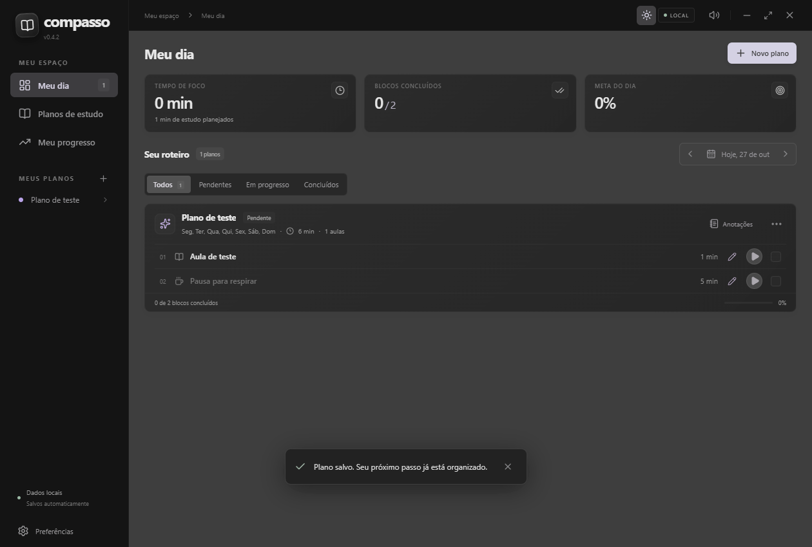
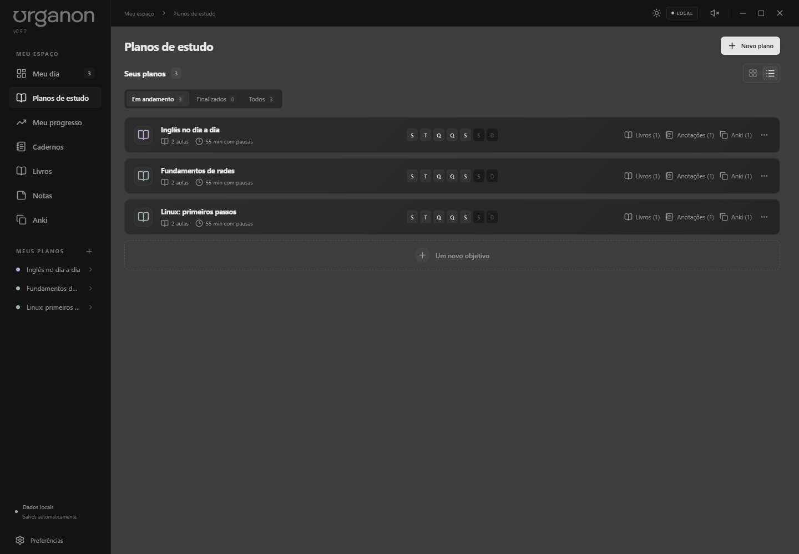
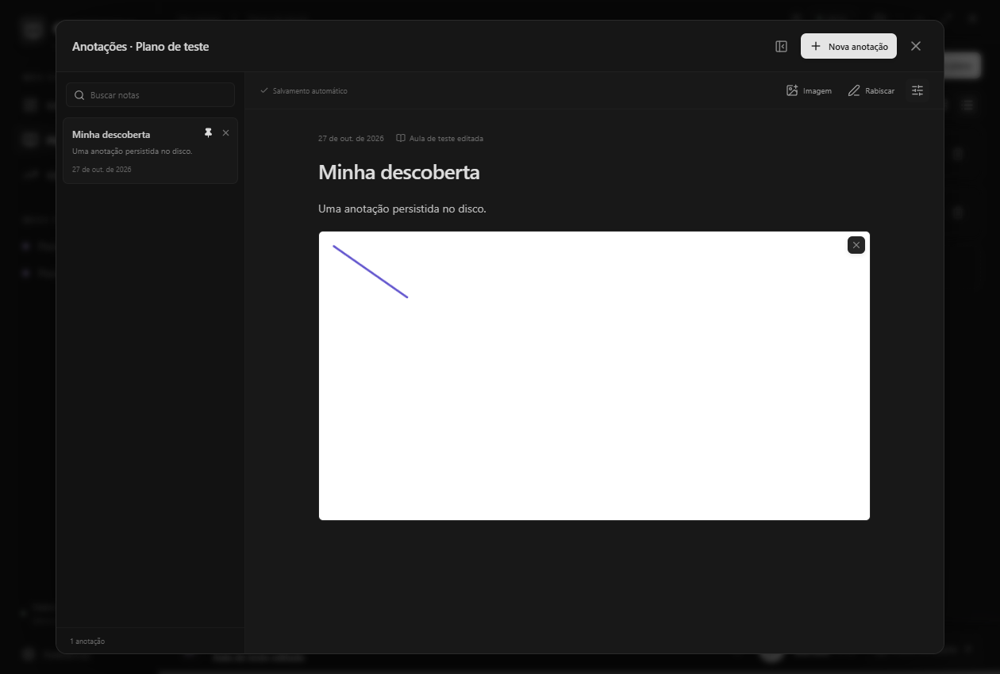
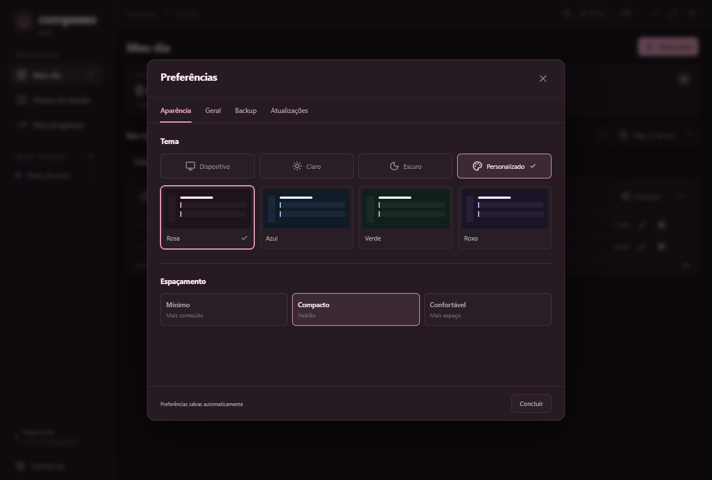
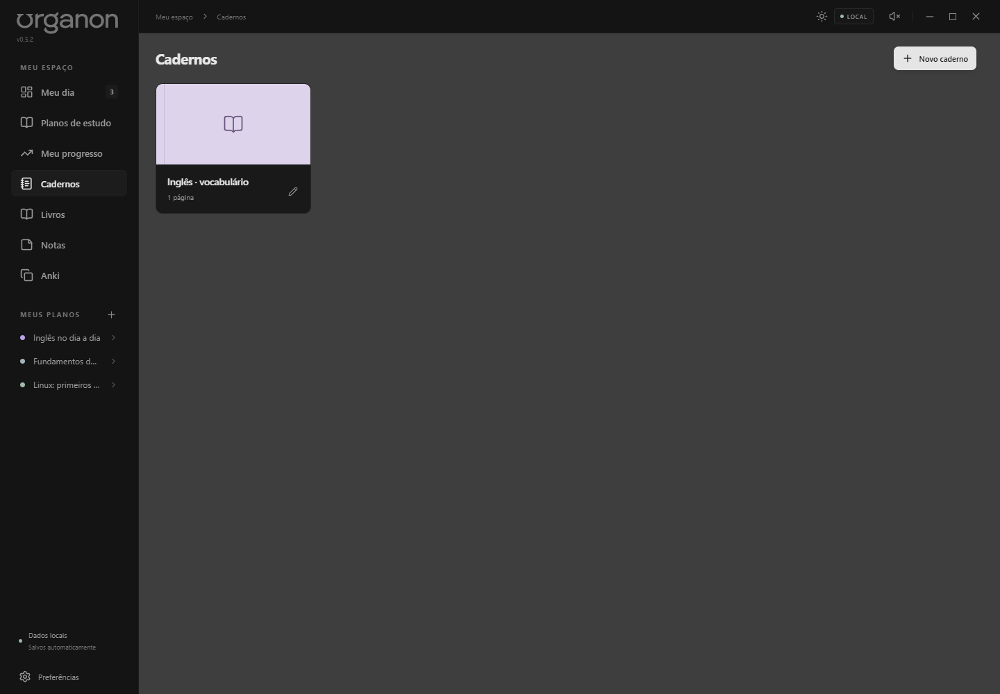
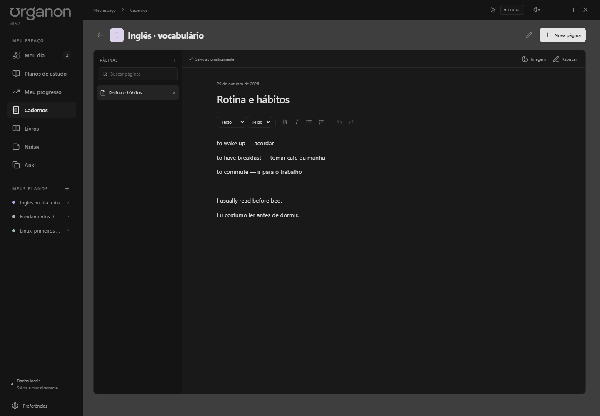
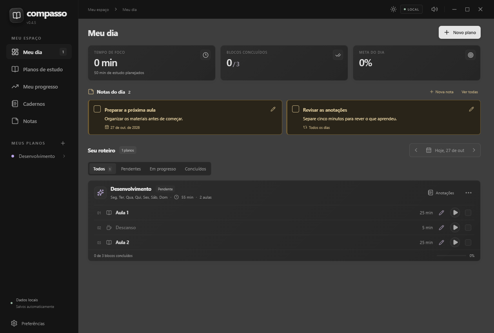
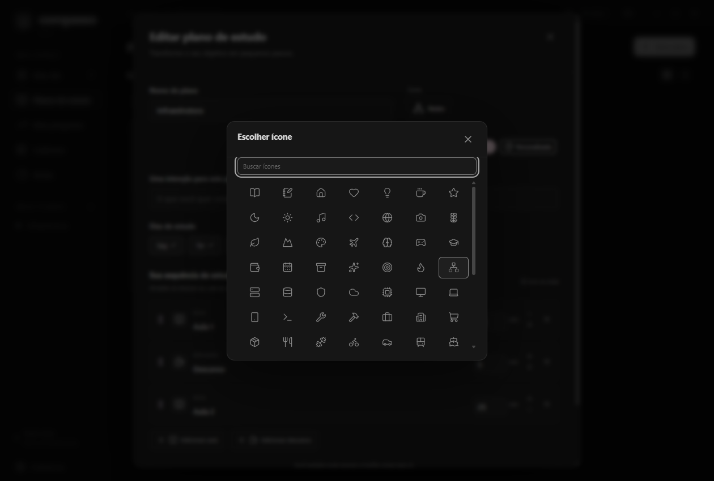
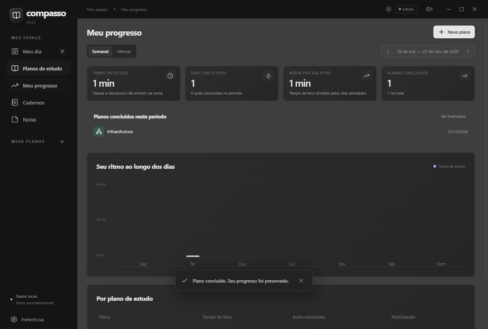
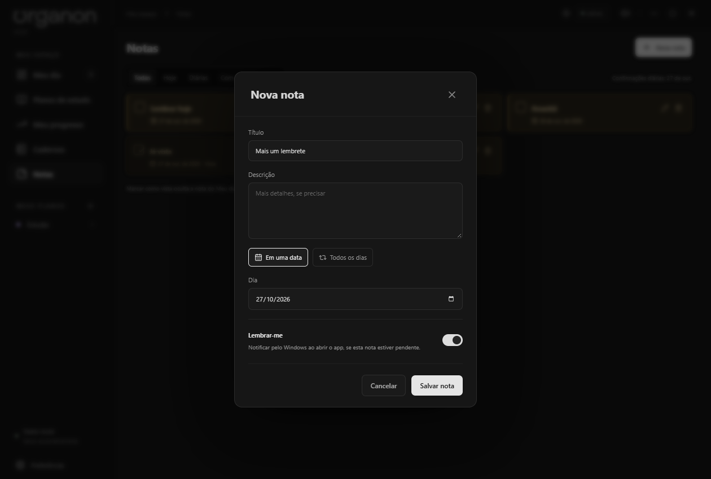

# Organon

Aplicativo para Windows com planos de estudo, cronômetro de aulas e descansos, histórico e cadernos pessoais com páginas, imagens e desenhos. Funciona localmente, sem conta e sem servidor. Feito com JavaScript, React, Vite e Electron.

A versão 0.5.0 mantém a biblioteca offline da 0.4.10 e corrige a identificação de previews e versões finais para o atualizador. A conexão com Supabase permanece desativada enquanto o servidor não é validado; o aplicativo segue offline, sem solicitar login. Consulte o [estado da configuração e os testes](docs/SUPABASE.md).

**[Baixar instalador para Windows · versão mais recente](https://github.com/leosalema213/app-estudos/releases/latest/download/Organon-Instalar.exe)**

[Versões e novidades](https://github.com/leosalema213/app-estudos/releases) · [Código-fonte](https://github.com/leosalema213/app-estudos)

O link de download permanece o mesmo em todas as versões publicadas. A versão em trabalho está no `package.json`; o instalador da última Release é a versão distribuída.





















O Organon era chamado Compasso. Os dados locais, identificadores internos e um instalador com o nome anterior são mantidos para compatibilidade com atualizações existentes.

## Abrir

Baixe e execute o instalador acima para adicionar o Organon ao menu Iniciar e à área de trabalho. O aplicativo verifica novas versões ao abrir e pergunta antes de baixar ou instalar uma atualização. Também é possível verificar manualmente nas preferências. Seus planos, histórico e anotações são mantidos na atualização.

Na instalação inicial, o instalador apresenta o aplicativo, permite escolher a pasta e pede confirmação antes de instalar. Ao concluir, mostra **Instalado com sucesso**, com a opção **Abrir o Organon agora** desmarcada para você escolher. As atualizações iniciadas pelo app são silenciosas: preservam a pasta existente e reabrem o Organon ao terminar, sem repetir o assistente.

Para testar uma compilação local, abra `Abrir Organon.lnk` ou `release/<versão>/win-unpacked/Organon.exe`. Mantenha a pasta `win-unpacked` completa. O instalador gerado fica em `release/<versão>/Organon-Instalar.exe`. Nenhuma dessas versões precisa de Node ou de um servidor para usar.

O instalador extrai o aplicativo apenas uma vez. O formato portátil opcional extrai o Electron numa pasta temporária a cada abertura e inicia mais lentamente. O motor do Electron representa a maior parte do tamanho em disco; o frontend é distribuído apenas no bundle, sem cópias extras de bibliotecas.

Para executar a partir do código:

```powershell
cd estudo-desktop
npm install
npm start
```

Para gerar a versão em pasta e o instalador:

```powershell
npm run dist
```

`npm run dev` abre somente o ambiente web de desenvolvimento. O modo compacto com janela flutuante requer o Electron (`npm start`). Depois de compilar, `npm run desktop` abre sem recompilar.

`npm run dist:portable` gera o formato portátil opcional. `npm run icon` renderiza o ícone a partir de `assets/icon.svg`, produzindo PNG e ICO com sete resoluções.

## O que você pode testar

- No primeiro uso, um tutorial curto orienta a criação do seu primeiro plano, com **Aula 1**, **Descanso** e **Aula 2** editáveis. Nenhum plano é adicionado automaticamente. O tutorial pode ser pulado; dados de versões anteriores são mantidos.
- Criar, editar, duplicar e excluir planos; escolher dias da semana e cores.
- Escolher o ícone de cada plano independentemente da cor, com mais de 70 opções e busca. A paleta oferece tons pastéis e uma cor personalizada.
- O seletor de ícones abre em um popup separado nos planos e cadernos. Escolher um ícone fecha o popup; X ou Escape volta à edição sem alterar a seleção.
- Concluir um plano inteiro para retirá-lo do Meu dia, preservando histórico e anotações. Em Planos de estudo, alterne entre **Em andamento**, **Finalizados** e **Todos**; planos finalizados podem ser reabertos.
- Em Meu progresso, consultar quantos planos foram concluídos na semana ou no mês selecionado, o total geral e a lista com as datas. Os checks de aulas e descansos continuam sendo diários e não encerram o plano automaticamente.
- Exibir os planos em **cards** ou **lista**, pelo seletor ao lado de Seus planos. A preferência fica salva.
- Adicionar aulas e descansos, renomear, ajustar duração e reordenar arrastando ou pelas setas.
- Criar tipos como Revisão, Exercícios ou Leitura pelo **+** na própria edição do plano, escolhendo nome e ícone. Os atalhos ocupam até duas linhas; quando não couberem todos, o botão de lista abre os demais. Tipos personalizados contam como foco e são reutilizados entre planos, sem nova seção na sidebar.
- Ver o roteiro da data selecionada, filtrando planos pendentes, em progresso e concluídos.
- Iniciar ou pausar qualquer bloco. Existe apenas um cronômetro ativo de cada vez.
- Ao terminar, o bloco é marcado e um aviso visual, sonoro e uma notificação do Windows são emitidos. O próximo bloco sempre começa manualmente. A notificação nativa depende das permissões de notificações do Windows.
- Marcar e desmarcar conclusões manualmente, separadamente por dia.
- O resumo de Meu dia e a meta diária contam todos os blocos programados, incluindo aulas e descansos. As horas de foco continuam excluindo os descansos.
- Editar o nome e a duração de cada aula ou descanso pelo lápis na própria linha, mantendo o tempo já estudado.
- Escolher três densidades nas preferências: **Mínimo**, **Compacto** (padrão) e **Confortável**. A escolha fica salva.
- Usar uma janela compacta de **340 × 112 px**, de tamanho fixo, arrastável pelo título e sempre sobre as outras janelas. O acesso fica em um ícone discreto no player. Expandir ou fechar esse modo retorna ao app e mantém o cronômetro.
- O modo compacto lembra sua última posição, inclusive após reiniciar. Se o monitor usado não estiver mais disponível, a janela retorna para uma área visível. Tamanhos personalizados de versões anteriores voltam ao padrão.
- Novos perfis seguem o tema do dispositivo. Alterações manuais pelo sol/lua ou pelas preferências ficam salvas, independentemente do Windows. Nas preferências, **Seguir dispositivo** restaura o modo automático. O escuro usa preto e cinzas neutros, com vidro nativo Acrylic no Windows 11 22H2 ou superior e fundo sólido nos sistemas sem suporte.
- Consultar horas de estudo, aulas concluídas e médias semanais e mensais. Descansos e pausas não contam como foco. Por padrão, marcar uma aula manualmente não acrescenta horas; nas preferências, a contagem manual pode ser ativada.
- Usar um caderno por plano, com páginas datadas, vínculo opcional com a aula, texto, imagens, prints colados e rabiscos. Imagens PNG/JPG/WebP de até 20 MB são otimizadas em segundo plano para até 1 MB; imagens antigas são preservadas.
- Escrever como em um documento: cole prints ou insira imagens e rabiscos na posição do cursor, continue o texto abaixo e intercale novos trechos. Desfazer/refazer e a ordem do documento são preservados durante a edição; conteúdo e posição ficam salvos ao reabrir. Notas antigas mantêm o texto seguido das imagens na ordem anterior.
- Expandir as últimas notas no próprio plano ou abrir o caderno ampliado. A lista tem busca e pode ser recolhida; textos longos crescem no editor, com uma única área de rolagem. A exclusão de uma nota pede confirmação separada.
- Fixar notas pelo ícone de alfinete: elas ficam primeiro no caderno e nas prévias do plano. A escolha é preservada ao reabrir e nos backups.
- Filtrar notas por uma data específica pelo calendário ao lado de Buscar notas, combinando com a busca por texto. A rolagem permanece dentro das modais enquanto estiverem abertas.
- Usar preferências separadas em Aparência, Geral, Backup e Atualizações. Em Aparência, escolha Dispositivo, Claro, Escuro ou Personalizado; o último oferece temas prontos em rosa, azul, verde e roxo. Tema, cor e espaçamento ficam salvos.
- Exportar e restaurar backup JSON, incluindo histórico e imagens.

A [auditoria de backup e o roteiro de reinstalação segura](docs/AUDITORIA-BACKUP.md) registram a cobertura, os testes e as correções da 0.4.9 em relação à 0.4.8. A [avaliação do Google Drive](docs/GOOGLE-DRIVE.md) compara pasta sincronizada e conexão direta; a integração com Drive ainda não foi implementada.

## Livros

A seção **Livros** importa PDF, EPUB refluível, MOBI, AZW e AZW3 sem DRM, até **200 MiB por arquivo**, inclusive sem plano. O Organon guarda uma cópia offline no perfil: mover o original não interrompe a leitura. Importar o mesmo conteúdo novamente mantém uma única entrada, com sua posição e seus vínculos.

O leitor abre dentro do aplicativo e retoma a última posição após fechar e reiniciar. Há uma ou duas páginas por tela, contraste papel/noturno/sépia, atalhos de navegação e maximizar/restaurar. Em PDF, use zoom, os botões −/+ ou **Ctrl + scroll**; o scroll sem Ctrl continua rolando normalmente. PDF tem layout fixo: ampliar a página não altera a fonte nem redistribui o texto. Não há OCR, reflow ou formulários de PDF nesta entrega. Em EPUB/Kindle, o controle **Fonte** e Ctrl + scroll ajustam a fonte, preservando um localizador CFI do início do trecho; o campo de posição usa porcentagem em vez de um número de página dependente da fonte.

**Ponto mais avançado** é a maior página exibida dividida pelo total; voltar uma página não reduz esse indicador. Ele não comprova leitura de todas as páginas. **Concluir** registra separadamente o livro como lido, na data do check; **Meu progresso** mostra os livros lidos no período semanal/mensal e o total. Abrir a última página não conclui o livro automaticamente e não cria horas de foco.

Em **Planos** no card do livro, escolha quantos planos quiser. Cada plano pode ter vários livros e oferece o botão **Livros**. Livros independentes permanecem na biblioteca sem obrigações no Meu dia. Excluir um plano não exclui livros. Excluir um livro pede confirmação e remove a entrada e sua participação no progresso; o original é preservado.

O backup JSON inclui PDFs, posição, preferências e vínculos. Restaure pelo aplicativo desktop; a visualização web não armazena binários de livros. Backups grandes usam memória durante a importação e podem demorar. Mantenha espaço para o JSON portátil (base64 acrescenta aproximadamente um terço ao tamanho dos PDFs) e para as cópias restauradas. Arquivos internos sem referência são retidos por segurança e não entram em novos backups.

PDF usa [PDF.js](https://github.com/mozilla/pdf.js), empacotado com worker, fontes e CMaps. EPUB/Kindle usam parsers e paginação do [Foliate.js](https://github.com/johnfactotum/foliate-js), fixado em uma revisão e empacotado offline. O conteúdo dos livros passa por remoção de scripts/handlers, política de recursos sem acesso externo e iframe sem permissão de scripts. EPUB de layout fixo, KFX e arquivos com senha/DRM não são suportados; não há conversor integrado.

O contrato de armazenamento, backup e transporte futuro está em [Dados e migrações](docs/DADOS-E-MIGRACOES.md). A nuvem continua desativada; snapshots com livros são recusados pelo transporte atual para impedir uma cópia online incompleta.

## Cadernos pessoais

Abra **Cadernos** na sidebar para criar espaços independentes dos planos, como Diário, Casa ou Pensamentos. Escolha nome, cor pastel ou personalizada e um ícone da biblioteca com busca, compartilhada com os planos. Tanto a imagem de capa quanto o ícone são opcionais: use **Sem ícone** para deixar somente a imagem ou a cor. Cada caderno pode ter várias páginas, com busca pelo título ou conteúdo.

O título da página aparece no índice da esquerda. Se ele estiver vazio, o primeiro título do texto identifica a página automaticamente. Dentro da página, títulos de nível 1, 2 e 3 formam outro índice clicável. Digite `# `, `## ` ou `### ` no início de uma linha para criar um título, ou use o seletor de estilo da barra.

A barra oferece negrito, itálico, tamanho de fonte, títulos, listas e desfazer/refazer. Imagens podem ser coladas, escolhidas por arquivo ou arrastadas para o texto; rabiscos usam a mesma posição do cursor. Páginas, capas e formatação ficam salvas localmente e entram no backup. Excluir uma página ou um caderno exige confirmação.

## Notas do dia e tempo manual

Em **Notas**, crie lembretes com título, descrição e uma data ou a opção **Todos os dias**. As notas pendentes aparecem abaixo dos indicadores de Meu dia, respeitando a data selecionada. Marcar como vista oculta a nota; quando todas forem vistas, a seção desaparece. Notas diárias voltam no dia seguinte. Na área Notas é possível editar, excluir ou desfazer a confirmação.

Cada nota tem **Lembrar-me**, desativado por padrão. Ao ativar, ela participa da notificação do Windows na abertura do aplicativo quando estiver prevista para hoje e ainda não tiver sido vista. Várias notas são agrupadas em um aviso com a quantidade. Clicar abre **Notas → Hoje**, restaurando a janela mesmo se estiver minimizada ou em modo compacto. A notificação não marca a nota como vista. Notas futuras, já vistas ou sem Lembrar-me ficam fora do aviso. A exibição segue as permissões de notificação e o modo Não incomodar do Windows.

Em **Preferências → Geral**, **Iniciar com o Windows** vem ativado e abre a janela normal ao entrar na conta. A escolha fica salva e pode ser desativada. O registro usa o executável em execução, é atualizado ao mudar de instalação e removido ao desinstalar. Prévias sem instalação, execuções de desenvolvimento e perfis temporários de teste guardam a preferência sem alterar a inicialização real do Windows. A inicialização automática é efetivada ao executar a versão instalada pelo instalador. Se a inicialização foi desativada pelo Gerenciador de Tarefas, a sincronização automática respeita essa escolha; para reativar pelo app, desligue e ligue a opção novamente.

Em **Preferências → Geral**, **Tempo ao concluir manualmente** vem desativado. Ao ativar, dar check completa o tempo cadastrado sem duplicar o que o cronômetro já registrou. Por exemplo, uma aula de 25 minutos com 3 cronometrados recebe 22 minutos manuais. Desfazer o check retira esses 22 minutos e mantém os 3 reais. Descansos continuam fora do tempo de foco. A preferência vale para todos os planos e fica salva.

## Persistência e comportamento do relógio

No Windows, os dados ficam em `%APPDATA%/compasso-estudos/compasso.json` (o Electron usa a pasta de dados do aplicativo). O arquivo é salvo automaticamente por substituição de um arquivo temporário. Durante uma sessão, o cronômetro atualiza a tela a cada segundo e grava um checkpoint a cada cinco segundos; pausar, editar planos ou trocar preferências salva imediatamente. Isso evita regravar cadernos e imagens a cada atualização visual. O fechamento normal também solicita uma gravação final. Sem sincronização e sem serviços externos.

Ao fechar e reabrir, o cronômetro fica pausado no último estado salvo; o tempo com o app fechado não conta. Minimizar ou usar o modo compacto mantém o timer ativo. O cálculo usa o relógio, evitando atraso acumulado dos intervalos. No Electron, o evento de suspensão do Windows pausa a sessão; ao voltar, retome manualmente. O tempo que atravessa meia-noite é distribuído entre as duas datas, e o check pertence ao dia em que o bloco começou.

Alterar um plano encerra o cronômetro dele, preservando o tempo já registrado. Excluir um plano remove seu caderno, mas conserva as horas no histórico. Duplicar cria uma sequência nova e um caderno vazio. Não há gravação ou reprodução de aulas em vídeo: o player é o cronômetro de estudo, para acompanhar o conteúdo que você abre em outra janela.

Na visualização web, a persistência usa o armazenamento do navegador, separado dos dados do aplicativo desktop. Exporte o backup para transportar os dados.

## Desenvolvimento e validação

```powershell
npm test
npm run build
npm run test:ui
npm run test:cloud
npm run test:notebook
npm run test:library
npm run test:reminders
npm run test:plans
npm run test:windows-startup
```

Os testes de modelo verificam conclusão automática, pausa, troca de aulas, descansos, distribuição diária, marcação manual e backups. O teste de interface abre uma instância isolada do Electron com dados temporários e verifica os fluxos principais. As capturas ficam em `test-output/`.

O teste do caderno verifica notas antigas, texto intercalado com prints e rabiscos, posição do cursor, desfazer/refazer, colagem durante troca de notas, backup e persistência após reiniciar. O editor é carregado somente ao abrir uma nota e armazena cada imagem uma única vez no documento.

O teste dos cadernos pessoais verifica criação e edição de cadernos, capas, páginas, formatação, títulos com Markdown, índices, busca, desenhos, exclusão com confirmação, layout em janela menor e persistência após reiniciar.

Os testes de inicialização verificam os parâmetros enviados ao Windows, ativação/desativação, falhas e preferências persistidas. O teste de interface usa os controladores de produção com adaptadores de sistema simulados para verificar a notificação agrupada e seu clique, sem registrar o executável de teste nem disparar avisos reais. Reiniciar ou entrar novamente no Windows não faz parte desses testes automatizados. O script de medição de abertura `tests/startup.cjs` continua separado.

Os testes também verificam edição individual, preferências de densidade, aviso de atualização, download e instalação somente após confirmação, além da rejeição de downloads corrompidos. Os testes de atualização simulam a execução do instalador; não instalam nada no computador.

Depois de `npm run dist`, execute `npm run test:installer` para validar o modo silencioso. O teste compila um programa NSIS mínimo usando a mesma macro de inicialização do instalador e os mesmos parâmetros do electron-builder. Ele apenas grava o modo escolhido e sai, sem instalar arquivos do app, criar atalhos ou alterar o registro. Cobre a instalação normal, os atualizadores antigos e o atual.

## Publicar uma versão

Antes de qualquer commit, push, tag ou Release, confirme com o usuário que o lote está encerrado e que ele autoriza a publicação, conforme `AGENTS.md`. PATCH vai de 0 a 9; após 9, avance MINOR e volte PATCH a zero (`0.5.9` → `0.6.0`). MAJOR só muda por pedido explícito. A Release 0.4.10 permanece no histórico; a correção seguinte é 0.5.0.

1. Prepare os testes locais com `npm run version:preview`: após 0.5.0, gera 0.5.1-preview.1 e, nas próximas chamadas, 0.5.1-preview.2 etc. Cada instalador entregue deve ter um identificador exclusivo. Quando o lote estiver pronto, `npm run version:final` prepara 0.5.1. Esses comandos atualizam os dois arquivos do pacote e o cabeçalho do changelog, preservando as notas existentes, e não fazem commit nem publicação. Não entregue o instalador estável antes da publicação.
2. Confira os resultados dos testes pertinentes ao lote. Conforme `AGENTS.md`, envie ao usuário um comando focado para execução no terminal dele quando houver validação pendente; reaproveite resultados válidos e não repita automaticamente suítes completas.
3. Gere os arquivos com `npm run dist` e `npm run checksums`.
4. Faça commit e envie para `origin/main`.
5. Execute `npm run release`.

O script usa a autenticação existente do Git, ou `GH_TOKEN`/`GITHUB_TOKEN` no ambiente. Credenciais não são gravadas em arquivos. Ele cria uma Release em rascunho, envia `Organon-Instalar.exe`, uma cópia idêntica `Compasso-Instalar.exe` para clientes anteriores e os respectivos checksums e só então publica como a versão mais recente. O README continua apontando para o mesmo endereço de download. Executáveis, dependências, dados de teste, atalhos e arquivos `.env` ficam fora do Git.

`npm run release` recusa previews e versões novas com PATCH maior que 9. Previews são instaladores locais identificados, sem publicação no canal de produção. A final é superior ao preview da mesma base (`0.5.1` > `0.5.1-preview.2`); o atualizador também continua entendendo versões legadas como 0.4.10. Não é feito downgrade de um preview de uma base futura para uma final anterior.

## Atualizações no aplicativo

Ao abrir, o Organon consulta a última Release pública de `leosalema213/app-estudos` sem bloquear a interface. Uma versão mais nova abre o aviso com as opções **Depois** e **Baixar atualização**. O download só começa após essa escolha e mostra uma barra de progresso. Quando termina, **Atualizar e reiniciar** pausa o cronômetro, salva os dados e aplica a atualização em segundo plano. O app fecha brevemente e reabre ao concluir. O instalador reconhece também os parâmetros enviados pelas versões 0.3 e 0.4, tornando esta atualização silenciosa para elas.

O pacote completo ainda é baixado a cada versão; não há download diferencial. O modo silencioso remove as etapas repetidas do assistente, mas não elimina o tempo necessário para baixar e substituir os arquivos. A versão instalada aparece abaixo da logo e nas preferências.

Depois de abrir e salvar os dados com sucesso, o app limpa os instaladores da versão atual e das anteriores no cache do atualizador. Downloads de versões futuras e arquivos baixados pelo navegador são preservados. Se o instalador ainda estiver em uso, a limpeza tenta novamente após 30 segundos e na próxima abertura.

O instalador é baixado exclusivamente das Releases deste repositório. O tamanho e SHA-256 são conferidos antes de oferecer a instalação e novamente antes de executar o arquivo. Sem conexão, o app continua funcionando e permite tentar novamente nas preferências. Versões antigas (0.1 e 0.2) precisam ser atualizadas manualmente uma vez para receber esse recurso.
